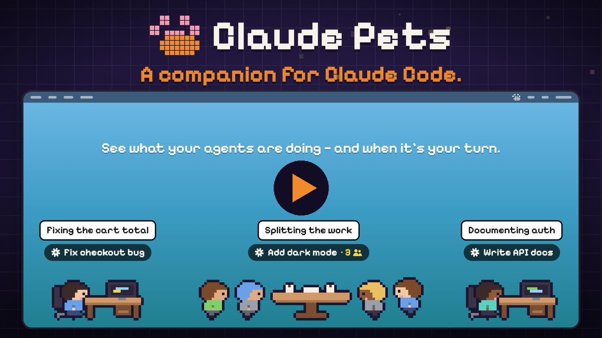
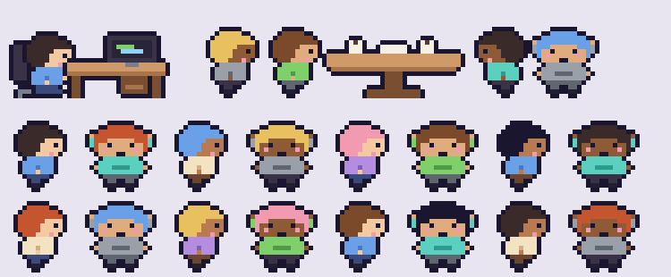

# Claude Pets

[English](README.md) · [Español](README.es.md) · [Português](README.pt.md) · **Français** · [Deutsch](README.de.md) · [Italiano](README.it.md) · [日本語](README.ja.md) · [简体中文](README.zh.md) · [한국어](README.ko.md)

Vos sessions [Claude Code](https://claude.com/claude-code) sous forme d'animaux 8-bit qui se promènent en bas de l'écran de votre Mac.

[](https://github.com/javiermiz/claude-pets/releases/download/v1.2.0/claude-pets-promo-en.mp4)




- **Chaque session active sur ce Mac est un animal.** Une session a toujours le même animal (il y en a 23), avec son nom affiché au-dessus.
- **Deux styles**, au choix dans le menu 🐾 : des animaux qui se promènent, ou des **employés** de bureau qui tapent à leur poste, font une **réunion d'équipe** autour d'une table quand leur session a des sous-agents, et sautent de joie quand ils ont fini.
- **Des bulles** disent ce que fait chaque agent en ce moment (⌨️ la commande, ✏️ le fichier qu'il modifie…) ou, quand c'est ton tour, ce qu'il t'a dit.
- **Mini-résumés** (optionnel) : si le CLI `claude` est connecté, Claude Haiku écrit une phrase de 7 mots pour chaque bulle, avec ton abonnement. Le menu 🐾 indique s'ils sont actifs et ouvre `claude /login` pour toi.
- **Une notification** (avec son) quand une session passe de « au travail » à « attend ta réponse ». Clique dessus pour ouvrir la session.
- Les animaux **au travail** se promènent. Ceux qui ont **terminé** se couchent avec un ✓ vert et attendent votre clic.
- **Cliquez** sur un animal pour ouvrir sa session dans l'application de bureau Claude.
- **Survolez-le** pour voir une fiche : projet, statut, depuis quand, sous-sessions et sous-agents actifs.
- Les **sous-agents** suivent leur session en file indienne, en plus petit. Les **sous-sessions** lancées depuis une autre session affichent un `↳`.
- **Le travail en arrière-plan compte :** une session qui attend des commandes ou des sous-agents en arrière-plan affiche ⏳ jusqu'à ce qu'ils finissent. Les commandes qui tournent depuis plus de 10 minutes (veilleurs, serveurs) ne comptent pas.
- **Les clics traversent** l'espace vide, la bande ne gêne jamais.
- **Parle ta langue :** English, Español, Português, Français, Deutsch, Italiano, 日本語, 简体中文, 한국어 (celle du Mac, ou celle choisie dans 🌐 du menu).


## Installation

Nécessite macOS 14 ou plus récent et les Command Line Tools de Xcode (`xcode-select --install`).

```sh
curl -fsSL https://raw.githubusercontent.com/javiermiz/claude-pets/main/install.sh | sh
```

L'installateur compile l'application depuis les sources sur votre Mac et la place dans `~/Applications/ClaudePets.app`. Vous pouvez ensuite l'ouvrir depuis Spotlight (« Claude Pets »).

Ou depuis un clone :

```sh
git clone https://github.com/javiermiz/claude-pets && cd claude-pets && ./build.sh
```

**Ou téléchargez l'application déjà compilée :** récupérez `ClaudePets.zip` dans les [Releases](https://github.com/javiermiz/claude-pets/releases/latest), décompressez-le et déplacez `ClaudePets.app` dans Applications. Elle n'est pas notarisée par Apple, donc macOS la bloque la première fois : ouvrez **Réglages Système → Confidentialité et sécurité** et cliquez sur **Ouvrir quand même**, ou lancez `xattr -dr com.apple.quarantine /Applications/ClaudePets.app`.

La 🐾 de la barre des menus propose **Ouvrir à la connexion** et **Quitter**. Un clic droit sur un animal quitte aussi l'application.

Pour mettre à jour, relancez la commande d'installation. Pour désinstaller, quittez l'application et supprimez `~/Applications/ClaudePets.app`.

## Fonctionnement

Tout est local et en lecture seule. La seule chose qui quitte ton Mac, ce sont les résumés optionnels (voir Limites).

| Quoi | Source |
| -- | -- |
| Sessions, nom, au travail/inactive | `~/.claude/sessions/<pid>.json` |
| Sous-agents (actif = écrit dans les 60 dernières s ; description depuis `*.meta.json`) | `~/.claude/projects/<project>/<session>/subagents/agent-*.jsonl` |
| Sous-sessions (depuis le transcript de la session parente) | `start_session` → `session_id: local_…` |
| Commandes en arrière-plan (processus enfants) | `zsh`/`bash` ⟵ `claude` |
| Ouvrir une session (lien profond de l'app de bureau) | `claude://code/continue?session=<id>` |
| Bulles (dernière action, dernier message) | `assistant` → `tool_use` / `text` |
| Mini-résumés (optionnel) | `claude -p --model haiku` |

Limites :

- Seules les sessions de ce Mac apparaissent. Les sessions cloud n'écrivent pas dans `~/.claude`.
- Seules les sessions vues au travail depuis le lancement de l'application apparaissent.
- Les résumés envoient à Anthropic de courts extraits de ce que font tes sessions (la dernière demande, les actions récentes ou le dernier message) via ta propre connexion Claude Code. Sans CLI connecté, rien n'est envoyé.

## Modifier les dessins

Les sprites sont écrits sous forme de code dans [`pets.px.js`](pets.px.js) avec pxl, un langage de pixel art. Chaque animal est un corps de 16×9 plus un style de pattes ; le cycle de marche, le contour et la pose couchée en sont générés. Les sprites déjà générés sont dans `assets/`, donc compiler l'application ne nécessite pas pxl. Après modification, régénérez les dessins et recompilez :

```sh
./sprites.sh && ./build.sh
```
