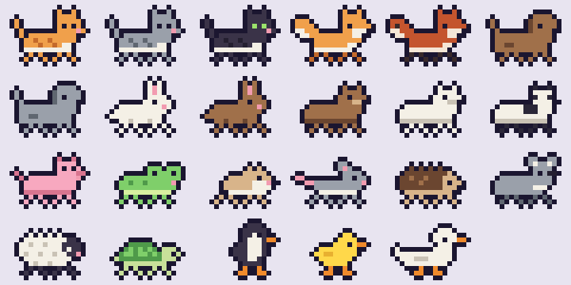
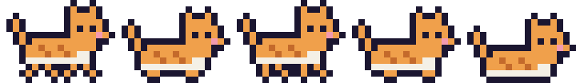

# Claude Pets

[English](README.md) · [Español](README.es.md) · [Português](README.pt.md) · **Français** · [Deutsch](README.de.md) · [Italiano](README.it.md) · [日本語](README.ja.md) · [简体中文](README.zh.md) · [한국어](README.ko.md)

Vos sessions [Claude Code](https://claude.com/claude-code) sous forme d'animaux 8-bit qui se promènent en bas de l'écran de votre Mac.



- **Chaque session active sur ce Mac est un animal.** Une session a toujours le même animal (il y en a 23), avec son nom affiché au-dessus.
- Les animaux **au travail** se promènent. Ceux qui ont **terminé** se couchent avec un ✓ vert et attendent votre clic.
- **Cliquez** sur un animal pour ouvrir sa session dans l'application de bureau Claude.
- **Survolez-le** pour voir une fiche : projet, statut, depuis quand, sous-sessions et sous-agents actifs.
- Les **sous-agents** suivent leur session en file indienne, en plus petit. Les **sous-sessions** lancées depuis une autre session affichent un `↳`.
- **Le travail en arrière-plan compte :** une session qui attend des commandes ou des sous-agents en arrière-plan affiche ⏳ et continue de marcher jusqu'à ce qu'ils finissent.
- **Les clics traversent** l'espace vide, la bande ne gêne jamais.
- **Parle votre langue :** English, Español, Português, Français, Deutsch, Italiano, 日本語, 简体中文, 한국어 (suit la langue du système).



## Installation

Nécessite macOS 14 ou plus récent et les Command Line Tools de Xcode (`xcode-select --install`).

```sh
curl -fsSL https://raw.githubusercontent.com/javiermiz/claude-pets/main/install.sh | sh
```

L'installateur compile l'application depuis les sources sur votre Mac et la place dans `~/Applications/ClaudePets.app`. Vous pouvez ensuite l'ouvrir depuis Spotlight (« Claude Pets »).

Ou depuis un clone :

```sh
git clone https://github.com/javiermiz/claude-pets && cd claude-pets && ./build.sh
```

**Ou téléchargez l'application déjà compilée :** récupérez `ClaudePets.zip` dans les [Releases](https://github.com/javiermiz/claude-pets/releases/latest), décompressez-le et déplacez `ClaudePets.app` dans Applications. Elle n'est pas notarisée par Apple, donc macOS la bloque la première fois : ouvrez **Réglages Système → Confidentialité et sécurité** et cliquez sur **Ouvrir quand même**, ou lancez `xattr -dr com.apple.quarantine /Applications/ClaudePets.app`.

La 🐾 de la barre des menus propose **Ouvrir à la connexion** et **Quitter**. Un clic droit sur un animal quitte aussi l'application.

Pour mettre à jour, relancez la commande d'installation. Pour désinstaller, quittez l'application et supprimez `~/Applications/ClaudePets.app`.

## Fonctionnement

Tout est local et en lecture seule. Rien ne quitte votre Mac.

| Quoi | Source |
| -- | -- |
| Sessions, nom, au travail/inactive | `~/.claude/sessions/<pid>.json` |
| Sous-agents (actif = écrit dans les 60 dernières s ; description depuis `*.meta.json`) | `~/.claude/projects/<project>/<session>/subagents/agent-*.jsonl` |
| Sous-sessions (depuis le transcript de la session parente) | `start_session` → `session_id: local_…` |
| Commandes en arrière-plan (processus enfants) | `zsh`/`bash` ⟵ `claude` |
| Ouvrir une session (lien profond de l'app de bureau) | `claude://code/continue?session=<id>` |

Limites :

- Seules les sessions de ce Mac apparaissent. Les sessions cloud n'écrivent pas dans `~/.claude`.
- Seules les sessions vues au travail depuis le lancement de l'application apparaissent.
- Un serveur qui tourne en arrière-plan (un serveur de dev…) fait marcher son animal jusqu'à ce que vous l'arrêtiez.

## Modifier les dessins

Les sprites sont écrits sous forme de code dans [`pets.px.js`](pets.px.js) avec pxl, un langage de pixel art. Chaque animal est un corps de 16×9 plus un style de pattes ; le cycle de marche, le contour et la pose couchée en sont générés. Les sprites déjà générés sont dans `assets/`, donc compiler l'application ne nécessite pas pxl. Après modification, régénérez les dessins et recompilez :

```sh
./sprites.sh && ./build.sh
```
